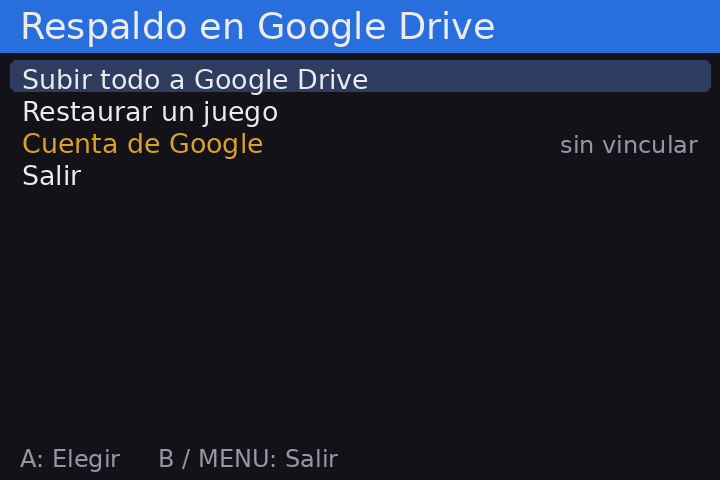

# Respaldo Drive para Anbernic

App para consolas **Anbernic con el sistema original** (chip H700, como la RG34XX SP) que guarda
**las partidas de todos tus juegos en Google Drive** y te permite recuperarlas **juego por juego**.

Se abre desde la sección **APPS** del menú, como el Reloj u otras apps de Anbernic.



## Qué hace

### Subir todo a Google Drive

Con un solo botón sube todas las partidas de la consola a tu Google Drive.

- La primera vez sube todo; las siguientes, **solo lo que cambió** (compara cada archivo con el que
  ya está en Drive), así que tarda segundos.
- Si una partida cambió, Drive **guarda la versión anterior en su historial**, por si la necesitas.
- Muestra el avance con una barra y, al terminar, cuántos archivos subió, cuántos no tenían cambios
  y si hubo errores.

### Restaurar un juego

Recupera las partidas de **un juego a la vez**, para no reemplazar nada por accidente:

1. Eliges **categoría → sistema → juego**.
2. La app muestra la fecha de la copia en Drive y la de la consola. Si la de la consola es **más
   nueva**, lo marca **en rojo** antes de que confirmes.
3. Antes de reemplazar, **guarda una copia de lo que había** en `SD1/anbernic/respaldo_nube/<fecha>/`.
   Si te equivocas, tu partida anterior sigue ahí.
4. Descarga todo primero y reemplaza los archivos de una vez, así nunca queda una partida a medio escribir.

### Qué partidas respalda

Revisa las dos tarjetas y organiza todo en Drive dentro de la carpeta **"Anbernic Saves"**:

| Categoría | Qué incluye |
|---|---|
| **RetroArch** | Partidas guardadas de todos los sistemas (`.srm`, `.sav`, `.eeprom`, …) |
| **RetroArch (estados)** | Estados guardados: el punto de reanudación automático (`.state.auto`) y los slots manuales (`.state`, `.state1`, …), agrupados por juego |
| **Emuladores independientes** | Emuladores fuera de RetroArch: partidas de GBC, de Nintendo DS (DraStic) y memorias VMU de Dreamcast (Flycast) |
| **Ports** | GTA III y GTA Vice City (**cada slot por separado**, para restaurar uno sin tocar los demás) y Zelda: Ocarina of Time (Ship of Harkinian) |

### Cuenta de Google

- La consola se vincula **con un código**, como una TV: no escribes tu contraseña en la consola.
- La app **solo puede ver los archivos que ella misma creó** en tu Drive, no tus otros documentos.
- Desde **Cuenta de Google** puedes desvincular la consola cuando quieras. Tus partidas en Drive no se borran.

### Botones

| Botón | Acción |
|---|---|
| **▲ ▼** | Moverse en las listas |
| **◀ ▶** o **L1 / R1** | Saltar una página en listas largas |
| **A** | Elegir / confirmar |
| **B** | Volver / cancelar |
| **MENU** | Salir de la app (durante una subida, la detiene) |

## Requisitos

- Consola Anbernic con chip **H700** y el **sistema original** de Anbernic (no Knulli, muOS, etc.).
- Pantalla de **720×480** (RG34XX SP, RG34XX H).
- **Wi-Fi** conectado. La hora de la consola debe ser correcta; se sincroniza sola al conectarse.
- Una cuenta de Google y unos 10 minutos para crear tu credencial (paso 1).
- No hay que instalar nada más: usa Python, `requests` y Pillow, que ya vienen en el sistema.

## Instalación

### Paso 1: crear tu credencial de Google (una sola vez)

La app no trae credenciales: cada persona usa **la suya**, gratis, desde Google Cloud.

1. Entra a [console.cloud.google.com](https://console.cloud.google.com) con tu cuenta y crea un
   proyecto nuevo (por ejemplo, "Anbernic Saves").
2. Ve a **APIs y servicios → Biblioteca**, busca **Google Drive API** y presiona **Habilitar**.
3. Ve a **Google Auth Platform → Comenzar** y completa:
   - **Nombre de la app:** "Anbernic Saves".
   - **Correo de asistencia:** tu correo.
   - **Público:** Externo.
4. En **Público → Usuarios de prueba**, agrega tu cuenta de Gmail.
5. En **Clientes → Crear cliente**, elige el tipo **"TVs y dispositivos de entrada limitada"**,
   ponle cualquier nombre y presiona **Crear**.
6. **Descarga el JSON** del cliente. Se llama parecido a `client_secret_XXXX.apps.googleusercontent.com.json`.

> **Ese archivo es privado.** No lo compartas ni lo subas a GitHub.

### Paso 2: copiar la app a la consola

La app va dentro de la carpeta `Roms/APPS` de cualquiera de las dos tarjetas (el menú lee las dos):

```
Roms/APPS/Respaldo Drive.sh
Roms/APPS/nube/main.py
Roms/APPS/nube/catalog.py
Roms/APPS/nube/drive.py
Roms/APPS/nube/fbui.py
Roms/APPS/nube/client_secret_XXXX.json      <- tu credencial del paso 1
Roms/APPS/Imgs/Respaldo Drive.png
```

#### Opción A: con la tarjeta en la PC

1. En esta página de GitHub, presiona **Code → Download ZIP** y descomprímelo.
2. Apaga la consola, saca una de las tarjetas microSD y ponla en la PC.
3. Abre la carpeta `Roms/APPS` de la tarjeta.
4. Copia ahí, desde la carpeta descomprimida:
   - el archivo `Respaldo Drive.sh`
   - la carpeta `nube` completa
   - el archivo `Imgs/Respaldo Drive.png` **dentro** de la carpeta `Imgs` que ya existe en `APPS`
     (no reemplaces esa carpeta: tiene los íconos de las otras apps).
5. Copia **tu JSON del paso 1** dentro de `Roms/APPS/nube/`.
6. Expulsa la tarjeta, vuelve a ponerla en la consola y enciéndela.

No hace falta copiar `docs`, `tools` ni el `README.md`.

#### Opción B: por Wi-Fi (SSH)

Si la consola tiene SSH activado, desde la carpeta del repositorio en la PC (cambia la IP por la de tu
consola; el usuario es `root` y la contraseña del sistema original es `root`):

```bash
scp -r "Respaldo Drive.sh" nube root@IP_DE_LA_CONSOLA:/mnt/mmc/Roms/APPS/
```

```bash
scp "Imgs/Respaldo Drive.png" root@IP_DE_LA_CONSOLA:/mnt/mmc/Roms/APPS/Imgs/
```

```bash
scp RUTA/client_secret_XXXX.json root@IP_DE_LA_CONSOLA:/mnt/mmc/Roms/APPS/nube/
```

`/mnt/mmc` es la tarjeta 1; para la tarjeta 2 usa `/mnt/sdcard`.

### Paso 3: vincular tu cuenta (la primera vez)

1. En la consola, entra a **APPS → Respaldo Drive → Subir todo a Google Drive**.
2. Aparece un código. En tu teléfono o PC abre **google.com/device** y escríbelo.
3. Entra con la cuenta que agregaste como usuario de prueba.
4. Si Google dice **"Google no verificó esta app"**, es normal porque la app es tuya: elige
   **Configuración avanzada → Ir a Anbernic Saves** y permite el acceso.
5. La consola lo detecta sola y empieza a subir.

> **Cada 7 días** Google pide vincular de nuevo mientras tu app de Google Cloud esté en estado
> **"Prueba"**. La app lo detecta y vuelve a mostrar un código; tus partidas en Drive no se pierden.
> Si publicas la app ("En producción", en **Google Auth Platform → Público**), deja de pasar.

## Actualizar o desinstalar

- **Actualizar:** copia de nuevo `Respaldo Drive.sh` y los archivos `.py` de `nube/` encima de los
  anteriores. Tu credencial y tu sesión (`token.json`) se conservan.
- **Desinstalar:** primero **Cuenta de Google → Desvincular** en la app, y después borra
  `Respaldo Drive.sh`, la carpeta `nube` y `Imgs/Respaldo Drive.png`. Tus partidas en Drive se
  quedan en la carpeta "Anbernic Saves".

## Problemas comunes

| Problema | Solución |
|---|---|
| No aparece en APPS | Revisa que `Respaldo Drive.sh` esté directamente en `Roms/APPS` y reinicia la consola. |
| Se abre y vuelve al menú enseguida | Falta tu `client_secret_….json` en `nube/`, o hay otro error: revisa `Roms/APPS/nube/log.txt`. |
| "No se pudo contactar a Google" | Activa el Wi-Fi de la consola y verifica que tenga internet. |
| Google rechaza el código o dice "acceso bloqueado" | Tu cuenta no está en **Usuarios de prueba**, o el cliente no es del tipo **"TVs y dispositivos de entrada limitada"**. |
| "La sesión venció" | Normal cada 7 días en modo Prueba: escribe el nuevo código en google.com/device. |
| Restauré algo por error | Tu partida anterior está en `SD1/anbernic/respaldo_nube/<fecha>/`, con la misma estructura de carpetas: cópiala de vuelta a su lugar. |

## Cómo funciona (técnico)

| Archivo | Qué hace |
|---|---|
| `nube/main.py` | Pantallas y flujo: menú, subida con barra de progreso, navegación para restaurar y confirmaciones. |
| `nube/catalog.py` | Encuentra las partidas y las clasifica en **categoría / sistema / juego** solo a partir de la ruta (`classify()`), así los archivos listados desde Drive se agrupan igual aunque ya no existan en la consola. |
| `nube/drive.py` | Cliente mínimo de Google Drive con `requests`. |
| `nube/fbui.py` | Dibujo en el framebuffer y lectura de botones (el mismo módulo que usa la app Monitor). |

Detalles de `drive.py`:

- **OAuth "device flow":** `POST /device/code` devuelve el código que se muestra en pantalla, y la app
  consulta `/token` cada pocos segundos hasta que lo apruebas. El `refresh_token` se guarda en
  `nube/token.json` y se renueva solo. Si Google lo rechaza (`invalid_grant`, por ejemplo a los 7 días
  en modo Prueba), lo borra y pide vincular de nuevo.
- **Permiso `drive.file`:** la app solo ve los archivos que creó.
- **Cada archivo en Drive guarda su ruta de la consola** en el campo `description` y la fecha de
  modificación local en `appProperties.mtime`. Así la restauración vuelve exactamente al mismo lugar
  y puede comparar fechas.
- **Subidas:** `multipart` para archivos de hasta 4 MB y **subida reanudable** (`uploadType=resumable`)
  para los más grandes, como los estados de Dreamcast (Drive no acepta multipart por encima de 5 MB).
  Las actualizaciones usan `PATCH` sobre el mismo archivo, así que Drive conserva el historial.
- **Restauración segura:** descarga todo primero, copia lo local a `respaldo_nube/<fecha>/`, escribe en
  un archivo temporal y lo reemplaza con `os.replace()`.

Para probar por SSH sin pantalla:

```bash
python3 nube/main.py --scan
```

```bash
python3 nube/main.py --remote
```

`--scan` lista las partidas encontradas en la consola y cómo se clasifican; `--remote` lista lo que
hay en Drive (requiere haber vinculado la cuenta).

## Seguridad

- El `.gitignore` excluye `client_secret*.json` y `token.json`. **Nunca subas esos archivos**: con
  ellos alguien podría acceder a lo que la app guardó en tu Drive.
- Para quitarle el acceso a la consola: **Cuenta de Google → Desvincular** en la app (revoca el token
  y lo borra), o desde [myaccount.google.com/permissions](https://myaccount.google.com/permissions).

## Compatibilidad

Probado en una **RG34XX SP** con el sistema original **1.0.6**.

## Licencia

[MIT](LICENSE) © 2026 Brandol1406
